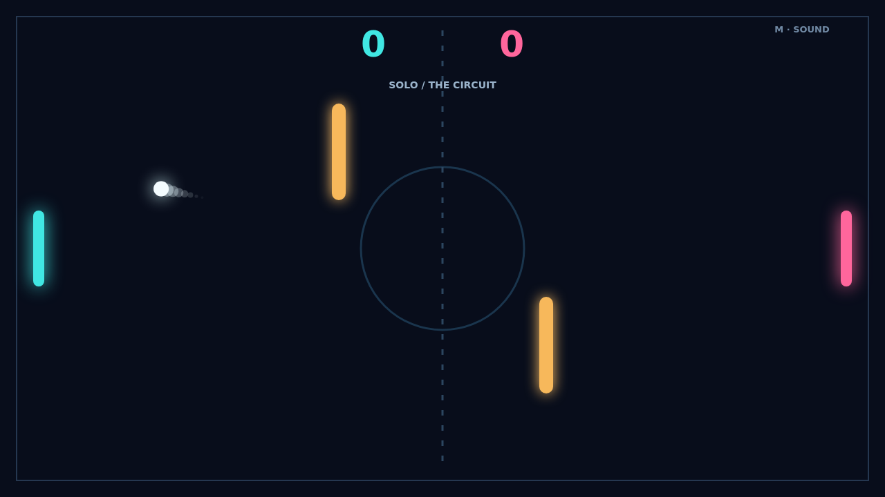

Carom puts a bright ball between two paddles on a dark court. The first serve cuts across the center line, and each return asks for a new angle. Reach 11 points with a two-point lead to take the match.

Move your paddle as the ball arrives and the strike carries spin. The ball's trail shows the curve taking shape, so a good return can bend away from a waiting opponent.

Two amber bars turn the middle of the court into a bank-shot puzzle. A clean ricochet can make space for a point, while a risky angle may send the ball straight back at you.

Face the AI in Solo or share a keyboard in Versus. A short countdown sets up every serve, and close games continue past 10–10 until someone pulls ahead.

